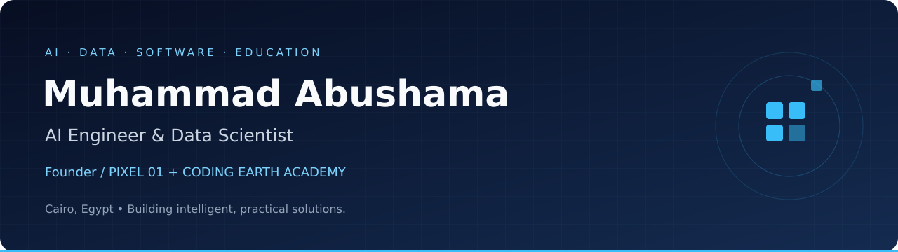

  

  <strong>Turning data into intelligent products. Turning ideas into working software.</strong>

  
  
  

## About me

I'm **Muhammad Abushama**, an AI Engineer, Data Scientist, and software founder based in Cairo, Egypt. I work across machine learning, natural language processing, computer vision, and business software — connecting research with practical applications.

- **Founder & CEO at PIXEL 01**, building software and data-driven solutions.
- **Founder of CODING EARTH ACADEMY**, teaching technology to kids and adults.
- Pursuing an **M.Sc. in Data Science at AAST**.
- B.Sc. in **Computer Science & Artificial Intelligence from Nile University**.
- Previous experience in **news analytics and NLP at Al-Ahram**, and AI instruction at **Udacity** and **almentor**.

## What I work on

| Area | Focus |
| :--- | :--- |
| **AI engineering** | LLM applications, retrieval-augmented generation, transformers, and model fine-tuning |
| **Data science** | Data preparation, predictive modeling, statistical analysis, and model evaluation |
| **Computer vision** | Image processing and deep learning with OpenCV, PyTorch, and TensorFlow |
| **Software products** | Business management systems, web applications, and offline desktop tools |
| **Technical education** | Practical AI curricula, workshops, and developer mentoring |

## Selected projects

A selection of my public software projects. These complement my AI and data science experience.

| Project | What it does | Explore |
| :--- | :--- | :--- |
| **PIXEL Carpets System** | Manages carpet sales, purchases, customers, factories, warehouses, treasury, and reports. | [Repository](https://github.com/muabushama/pixel-system-carpets) |
| **B LIVE-STATS** | An offline Windows desktop application for live handball statistics, with local data storage and period reports. Built with Electron and Dexie/IndexedDB. | [Repository](https://github.com/muabushama/b-livestats) |
| **Oasis Suite** | A web application with customer service, sales representative roles, invoices, maintenance, work orders, and visits. Uses React, TypeScript, Vite, PHP, and MySQL. | [Repository](https://github.com/muabushama/cleanwater) |

  <a href="https://github.com/muabushama?tab=repositories"><strong>Explore all public repositories →</strong></a>

## Tools & technologies

**AI & machine learning**

**Data & analytics**

Pandas · NumPy · SQL · PostgreSQL · Matplotlib · Seaborn · Plotly · Vector databases

**LLMs & deployment**

Transformers · RAG · LoRA · Whisper · FastAPI · Docker · Linux · Git · CUDA

## Experience at a glance

| Role | Organization | Period |
| :--- | :--- | :--- |
| Founder & CEO | PIXEL 01 | Jan 2026 – Present |
| Data Scientist | PIXEL 01 | Feb 2026 – Present |
| Data Scientist | AK TECH | Dec 2025 – Present |
| Data Scientist | Al-Ahram Newspaper | May 2025 – Nov 2025 |
| AI Instructor | Udacity | Nov 2024 – Apr 2025 |
| AI Instructor | almentor | May 2023 – May 2024 |
| Founder | CODING EARTH ACADEMY | Aug 2021 – Present |

## Let's build something useful

Interested in **AI applications, data science projects, business software, or technical training**?

**[Get in touch → muabushama@gmail.com](mailto:muabushama@gmail.com)**

Arabic: Native · English: Advanced

